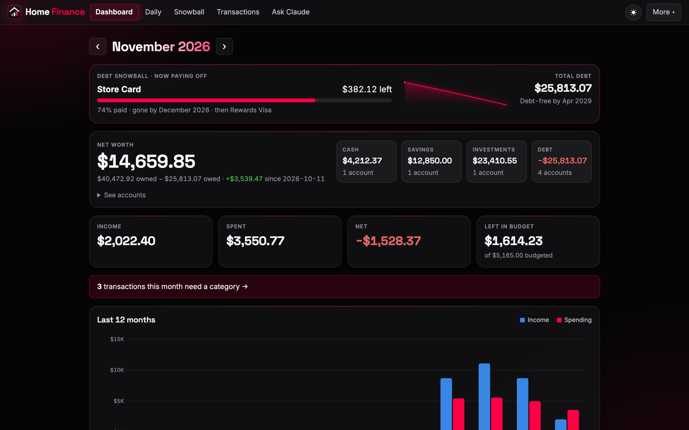
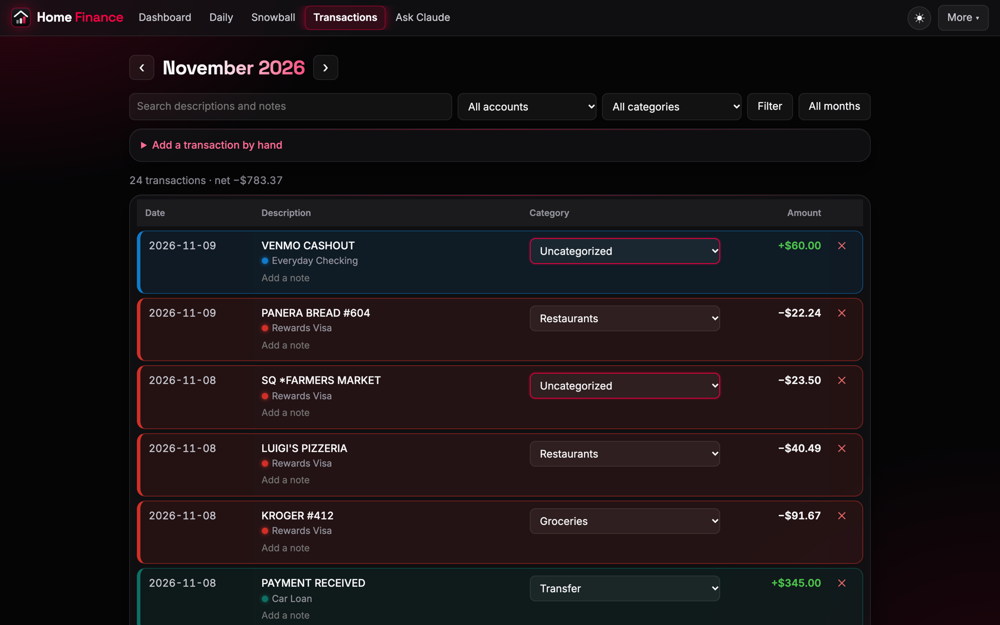
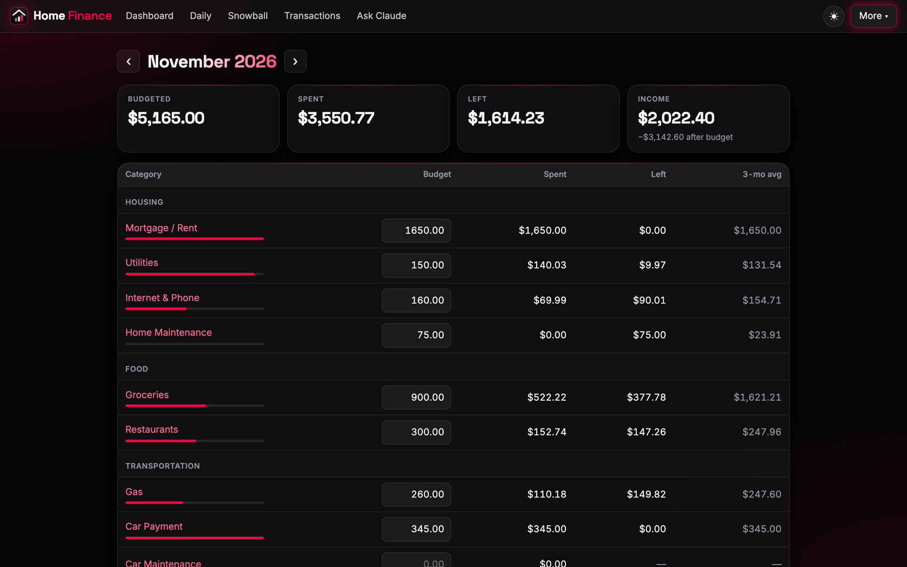
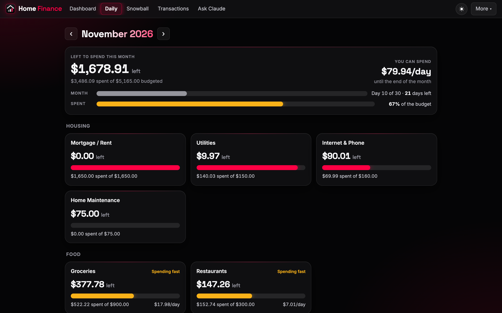
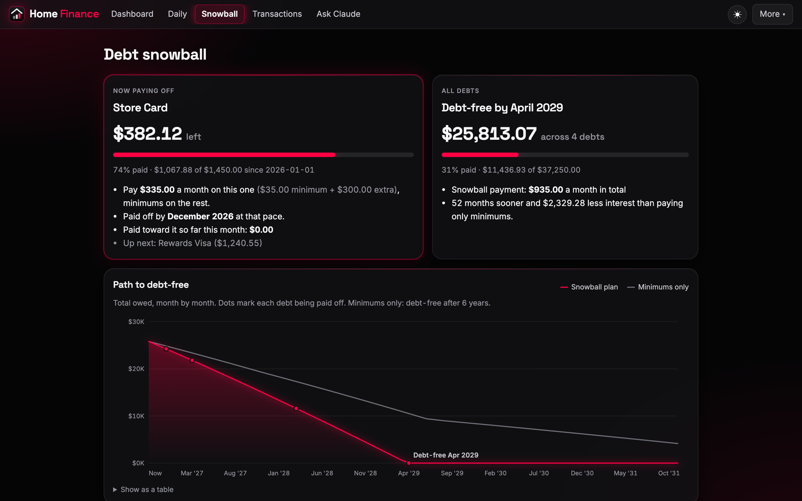
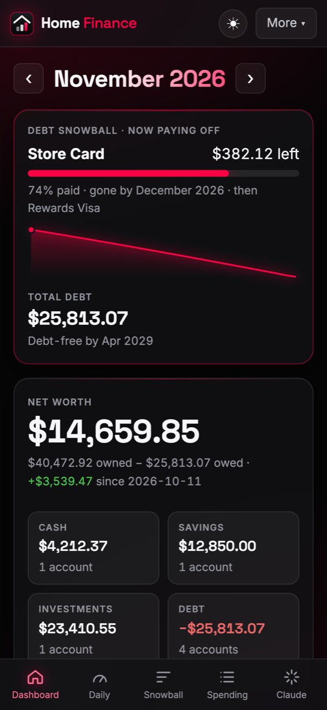
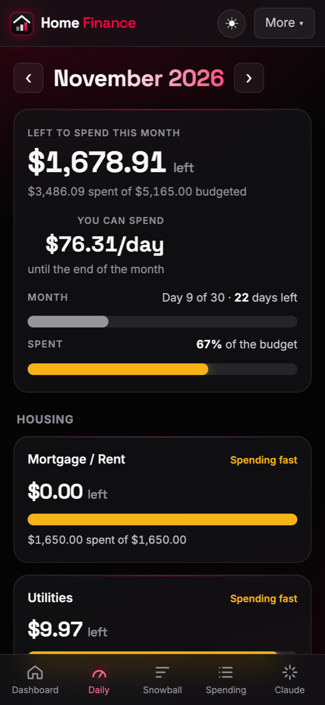

# Home Finance

A private household budget app that runs on your own computer. Import or sync your bank
transactions, sort them into categories, set a monthly budget, track net worth, and plan your way
out of debt. Your data stays in one file on your computer. Phones and other computers on your
home Wi-Fi can open it too.

**[Download the latest release](https://github.com/JPMixing-inc/home-finance-app/releases/latest)**
(Mac with Apple silicon, Windows 10/11)



## What it does

- **Dashboard:** this month's spending against your budget, net worth, and the last 12 months at a glance.
- **Transactions:** search, filter, categorize, add notes. Rules sort recurring merchants automatically.
- **Budget:** a monthly amount per category, copied forward from the last month in one click, with a
  daily pace view so you know whether you're on track halfway through the month.
- **Import:** CSV, OFX and QFX files from any bank. Duplicates are skipped, and a mistaken import
  can be undone.
- **Bank sync (optional):** connect banks through [Plaid](https://plaid.com) and new transactions
  and balances arrive every 2 hours. [Setup guide below](#bank-sync-with-plaid).
- **Debt snowball:** pay off debts smallest-first, see your debt-free date, and import student
  loans from a servicer's statement PDF.
- **Claude AI (optional):** ask questions about your money in plain English, get category
  suggestions for uncategorized transactions, and a short write-up of each month.
  [Setup guide below](#ai-features-with-claude).
- **Several logins:** each person in the household gets their own username and password.
- **Phone access:** scan a QR code in Settings to open it on your phone. On an iPhone, "Add to Home
  Screen" makes it feel like an app.
- **Backups:** download the whole database or export transactions as CSV any time.
- **Automatic updates:** checks GitHub for a new version when it starts and installs it in one click.

## Screenshots

*All numbers are from a made-up demo household.*

| | |
|---|---|
|  |  |
| **Transactions:** categorize with one click; uncategorized ones are highlighted. | **Budget:** set amounts per category and compare with your 3-month average. |
|  |  |
| **Daily:** what's left this month, and how much you can spend per day. | **Debt snowball:** your debt-free date and how much sooner the snowball gets you there. |

**On your phone** (open the address from Settings → Phone access, then Add to Home Screen):

<p>
  
  &nbsp;
  
</p>

## Install

### Mac
1. Download **HomeFinance-Mac-AppleSilicon.dmg** from the
   [latest release](https://github.com/JPMixing-inc/home-finance-app/releases/latest).
2. Open it and drag **Home Finance** into **Applications**.
3. Open Home Finance. macOS will say it can't verify the developer, because the app isn't signed.
   Click **Done**, go to **System Settings → Privacy & Security**, scroll down, and click
   **Open Anyway**. You only need to do this once.

> Intel Mac? The download is built for Apple silicon. See [Run from source](#run-from-source)
> or [build it yourself](#building-the-apps).

### Windows
1. Download **HomeFinance-Windows-Setup.exe** from the
   [latest release](https://github.com/JPMixing-inc/home-finance-app/releases/latest) and run it.
   If "Windows protected your PC" appears, click **More info → Run anyway**.
2. Click **Install**. It installs just for you, so there's no admin prompt, and adds Home Finance
   to the Start menu (and the desktop, if you tick that box).
3. When Windows asks about the firewall, allow **Private networks** so your phone can connect.

To uninstall, use **Settings → Apps**. Your data folder is kept.

> The release also has a **HomeFinance-Windows.zip**. Ignore it; version 1.1.0 uses it to update
> itself.

### First run
Home Finance opens to a **Create login** page. Pick a username and password; you can add logins for
others under **Settings** later. Then:

1. **Accounts:** add your checking, savings, credit cards and loans (or let bank sync create them).
2. **Import:** upload a CSV/OFX/QFX export from your bank, *or* set up [bank sync](#bank-sync-with-plaid).
3. **Categories:** tweak the starter categories and add rules such as "AMAZON → Shopping".
4. **Budget:** set an amount for each category.

### Using it on your phone
Open **Settings → Phone access** (or **Tools → Phone Access** in the menu bar). Scan the QR code with
your phone's camera, or type the address shown (something like `http://192.168.1.20:8090`), and sign
in. The phone has to be on the same Wi-Fi, and the app has to be open on the computer; minimizing it is
fine. Click **Turn off phone access** if you only want to use it on the computer.

### Updates
Each time Home Finance starts, it checks this repository for a newer release. If there is one, it asks
**"Update now?"**, and a banner appears at the top of the app. Choosing to update:
1. downloads the new version from the GitHub release,
2. checks it against GitHub's SHA-256 checksum,
3. installs it over the old one and reopens Home Finance.

Your data folder is never touched. You can also use **Tools → Check for Updates…**, or turn the
startup check off under **Settings → Updates**. Updates can only be started on the computer running
the app, not from a phone.

The Mac app needs to be in **Applications** (or another folder you can write to) to update itself.
Otherwise the update page offers a download link instead.

---

## Bank sync with Plaid

Plaid is the service many finance apps use to read bank data. You sign in to your bank in Plaid's own
window, so Home Finance never sees your bank password, and access is **read-only** (transactions and
balances). You use **your own** Plaid account, so your data goes from Plaid to your computer and
nowhere else.

**Cost:** Plaid's free **Trial plan** covers up to **10 bank logins** for developers in the US and
Canada. Each bank you sign in to counts as one, even if it has several accounts. Removing a
connection doesn't give the slot back, so connect thoughtfully. Plaid's
[billing docs](https://plaid.com/docs/account/billing/) have the current terms.

### 1. Create a Plaid account
1. Go to **[dashboard.plaid.com/signup](https://dashboard.plaid.com/signup)** and sign up with your
   email. Verify the email.
2. If asked what you're building, say it's for **personal use** (personal finance / budgeting app).
3. On the Dashboard home page, find the **Trial plan** and fill in its short form to get access to
   real banks (Plaid calls this **Production**). Approval is usually quick. Until then you can still
   test with the fake **Sandbox** bank.

### 2. Copy your keys
1. In the Plaid Dashboard, open **Developers → Keys**.
2. Copy your **client_id**. It's the same for every environment.
3. Copy the **Production** secret. To try the fake bank first, copy the **Sandbox** secret instead.

### 3. Paste them into Home Finance
1. In Home Finance, open **Bank sync**. It's under **More** in the menu, or go to `/connections`.
2. Paste the **client_id** and **Secret**, choose **Production (real banks)** or
   **Sandbox (fake test bank)**, and click **Save keys**.
3. Click **Connect a bank**, search for your bank, and sign in.
   - In **Sandbox**, use the username `user_good` and password `pass_good`.
4. For each bank account, choose which Home Finance account it fills, or leave it on
   **New account**. Then click **Save & sync**. The first sync pulls up to **2 years** of history.

From then on Home Finance syncs every 2 hours while it's running. **Sync all now** syncs right away.
If a bank needs you to sign in again, the connection shows a **Log in again** button.

### Plaid troubleshooting
- **Chase (and some other big banks) won't sign in inside the app window.** Choose
  **Tools → Open in Web Browser** and click **Connect a bank** there. The connection then works in
  the app too.
- **Big banks such as Chase, Bank of America, Wells Fargo and Capital One use "OAuth"** (you're sent to
  the bank's own site). Plaid may ask you to finish your **company/application profile** in the
  Dashboard before those banks work. If one says it isn't available, check the Dashboard for an
  OAuth or Production checklist. Plaid's [OAuth guide](https://plaid.com/docs/link/oauth/) has the details.
- **"Invalid client_id or secret":** make sure the secret matches the environment you picked.
  A Sandbox secret only works with Sandbox.
- Your Plaid keys are stored in `plaid.json` in your data folder, separately from the database, so a
  downloaded database backup can't be used to pull bank data on its own.

---

## AI features with Claude

Home Finance can use Anthropic's Claude to:
- **Ask Claude:** answer questions like "How much did we spend on restaurants this year compared to
  last?" Claude looks the answer up in your data. It can read your data but can't change anything.
- **Category suggestions:** propose categories (and rules) for uncategorized transactions. Nothing
  changes until you review the suggestions and click **Apply**.
- **Monthly summary:** a few bullet points on how the month is going, shown on the dashboard.

It uses **your own Anthropic API key** and is billed pay-as-you-go by Anthropic. This is separate
from a Claude.ai Pro/Max subscription, which doesn't include API usage. A question or summary
typically costs a few cents. **Settings** shows an estimate of what you've spent this month.

### 1. Create an Anthropic account and add credit
1. Go to **[platform.claude.com](https://platform.claude.com)** (the Claude Console; the old
   console.anthropic.com address still works) and sign up.
2. Open **Settings → Billing** (shown as **Plans & Billing** on some accounts) and **add credits**.
   API usage is prepaid; $5 is plenty to start. You can turn on auto-reload or set a monthly spend
   limit there too.

### 2. Create an API key
1. Open **Settings → API keys** (or go straight to
   [platform.claude.com/settings/keys](https://platform.claude.com/settings/keys)).
2. Click **Create Key**, name it something like "Home Finance", and click **Create**.
3. **Copy the key now.** It starts with `sk-ant-` and is shown only once. If you lose it, delete it and
   make a new one.

### 3. Paste it into Home Finance
1. In Home Finance open **Settings** and find the **Claude** section.
2. Paste the key and click **Save key**. Home Finance checks that it works.
3. Try **Ask Claude** in the menu, or **Write a summary** on the dashboard.

To stop using it, click **Remove** next to the key in Settings, or delete the key in the Claude Console.

**Privacy note:** when you use an AI feature, the relevant data (such as transaction descriptions,
amounts and categories) is sent to Anthropic's API to produce the answer. Nothing is sent unless you
use one of these features. The key is stored in `anthropic.json` in your data folder.

---

## Your data

| | Mac | Windows |
|---|---|---|
| Data folder | `~/Library/Application Support/Home Finance` | `%APPDATA%\Home Finance` |

Open it from the app with **Tools → Show Data Folder**. It holds:
- `finance.db`: everything (accounts, transactions, budgets, logins). Back it up with
  **Settings → Download a backup**, or copy the folder while the app is closed.
- `plaid.json` and `anthropic.json`: your API keys, if you added them.
- `server.json`: the port (default `8090`; the next free port is used if it's taken).
- `home-finance.log`: diagnostics if something goes wrong.

**Moving to a new computer:** install the app there, open and quit it once, then copy your old data
folder over the new one. Updating the app never touches the data folder.

**Security:** logins are required, passwords are hashed with scrypt, and money is stored as integer
cents. Phone access uses plain HTTP on your local network, so keep it to a home network you trust and
turn it off in Settings on public Wi-Fi.

---

## For developers

**Stack:** Python 3.13, FastAPI, Jinja templates, SQLite, vanilla JS. No front-end build step.
The desktop app is the same web app inside a [pywebview](https://pywebview.flowrl.com/) window,
packaged with PyInstaller.

### Run from source
The start scripts use [uv](https://docs.astral.sh/uv/), installing it if needed, to fetch Python 3.13
and the dependencies, then open the app in your browser:
- **Mac/Linux:** double-click `Start Home Finance.command` or run `./"Start Home Finance.command"`
- **Windows:** double-click `Start Home Finance.bat`

Or by hand: `pip install -r requirements.txt && python run.py` (`--port`, `--data FOLDER`, `--no-browser`).

### Self-host on a server or NAS (Docker)
```sh
docker build -t home-finance .
docker run -d --name home-finance -p 8090:8090 -v home-finance-data:/srv/data \
  -e TZ=America/New_York --restart unless-stopped home-finance
```
In server mode there's no Phone access switch: anyone who can reach the port sees the login page.
Put it behind HTTPS (a reverse proxy) if it's reachable from outside your home.

### Building the apps
- **Mac:** `./build-mac.sh` produces `dist/Home Finance.app` and `dist/HomeFinance-Mac-<chip>.dmg`,
  built for the chip of the Mac you run it on.
- **Windows:** install [Inno Setup 6](https://jrsoftware.org/isdl.php), then run `build-windows.bat`
  on Windows to get the installer, `dist\HomeFinance-Windows-Setup.exe` (plus the zip that 1.1.0
  needs to update itself). The installer recipe is
  [`packaging/windows-installer.iss`](packaging/windows-installer.iss).
- **GitHub Actions:** [`.github/workflows/build.yml`](.github/workflows/build.yml) builds and smoke-tests
  both (on Windows: install, start, uninstall). A manual run from the Actions tab also tests a Windows
  self-update from the latest release.

**Releasing a new version:**
1. Set `VERSION` in [`app/version.py`](app/version.py), e.g. `"1.2.0"`.
2. Rewrite [`RELEASE_NOTES.md`](RELEASE_NOTES.md). It becomes the release page, and the app's update
   screen shows it as "What's new".
3. Commit, then `git tag v1.2.0 && git push && git push --tags`. The build refuses a tag that doesn't
   match `app/version.py`. When it finishes, everyone's app offers the update the next time it starts.

The apps are unsigned. Removing the first-run warnings needs an Apple Developer ID (notarization)
and a Windows code-signing certificate.

### Layout
| Path | What |
|---|---|
| `app/main.py` | pages and routes |
| `app/db.py` | schema, migrations, default categories |
| `app/importers.py` | CSV/OFX/QFX parsing and duplicate detection |
| `app/bank_sync.py` | Plaid sync (runs every 2 hours) |
| `app/ai.py` | Claude features |
| `app/snowball.py`, `app/ledger.py`, `app/networth.py` | debt plan, transfers/payments, net worth |
| `app/local.py` | own-computer mode: phone access switch, QR code |
| `app/updater.py`, `app/version.py` | update check and self-install from GitHub releases; the version number |
| `app/templates/`, `app/static/` | HTML, CSS, JS |
| `desktop.py` | desktop app (window and background server) |
| `run.py` | shared startup code and the browser-based launcher |
| `HomeFinance.spec`, `packaging/` | PyInstaller recipe and icons |

## License

[MIT](LICENSE). Use it, change it, share it.
